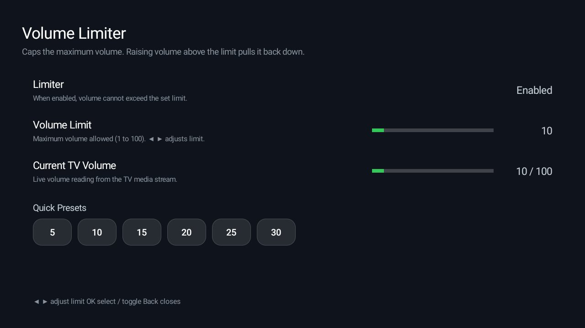

# Add-ons

Small, optional Android TV apps that plug into the launcher as a **module card**, kept in this repo
so they are easy to find, build and review. The launcher in [`launcher/`](../launcher/) never
depends on them: it is built, tested and size-checked without this folder, so an add-on can't make
the core bigger or change how it behaves. You install an add-on only if you want it.

## Add-ons

| Add-on | What it does | Author | Tested on | Permissions | Screenshot |
|---|---|---|---|---|---|
| [Frigate Glance](frigate-glance/) | Frigate camera pop-ups over whatever is playing | [NickLD](https://github.com/NickLD) | TCL 65Q650G | overlay, accessibility (card keys), network, foreground service |  |
| [Capacity Stats](capacity-stats/) | Available/total and used/total RAM; available/total storage | [lionlev21](https://github.com/lionlev21) | Android TV 12 (model private) | None | wanted |
| [Weather](weather/) | The weather for one city: now, US air quality and the next three days, from Open-Meteo (no key) | [@Sumyabazar1](https://github.com/Sumyabazar1) | Hisense SmartTV 4K FFM (lushan), Google TV 12 | `INTERNET` |  |
| [Photo Prints](photo-prints/) | Your own photos as a screensaver: dated prints dealt in on a time-of-day sky, and a card that starts the slideshow | [@shivamsingh262](https://github.com/shivamsingh262) | Sony BRAVIA KD-65X82L (Google TV 12) | None | wanted |
| [Photo screensaver](photo-screensaver/) | Your own pictures and MP4 clips as the TV's screensaver and as a card, slowly zooming and crossfading (20 s each by default); optional time, photo dates, prints on a sky and weather | [JorickGU](https://github.com/JorickGU) | TCL 43P69K (Google TV 12) | `INTERNET` and coarse location, only with the weather option on | wanted |
| [Prayer Times](prayer-times/) | Today's prayer times for one city from Aladhan (no key), the next prayer with a countdown, Gregorian and Hijri dates | [@majnioui](https://github.com/majnioui) | Xiaomi TV (MiTV-MOOR2), Google TV 11 | `INTERNET` |  |
| [TV Hub](tv-hub/) | One live-TV guide for M3U/XMLTV playlists, Dispatcharr and HDHomeRun tuners, with a Media3 player and shortcuts to installed live-TV apps | [@maxhayim](https://github.com/maxhayim) | MOKA R8G (Android TV 14) | `INTERNET` |  |
| [Headphones](headphones/) | Bluetooth headphones made easy: where the sound goes, paired pairs with battery, a pairing shortcut, and a quiet guard that pauses and mutes the speakers when headphones drop | [@maxhayim](https://github.com/maxhayim) | MOKA R8G (Android 14) | Bluetooth (paired devices only) |  |
| [TV Static](tv-static/) | An off-the-air moment each time the screen turns on: the picture opens from a bright line, snow and hiss, colour bars or an old "no signal" screen for 3 to 10 s, then fades into what was on screen; the card sets style, sound and length | [@luyzfernando08](https://github.com/luyzfernando08) | Xiaomi Mi Box S (Android TV 9), Philco by Skyworth (Android TV 14) | foreground service (screen-on watcher), start at boot, display over other apps |  |
| [Brightness](brightness/) | Dims the picture below the TV's own minimum over every app (and the picture settings on Realtek TVs), with a warm night mode on a schedule and a one-press normal screen | [@maxhayim](https://github.com/maxhayim) | MOKA R8G (Android 14) | overlay, foreground service, start at boot |  |
| [Sleep Timer](sleep-timer/) | A sleep timer: 15 to 120 minutes, a one-minute countdown over what is playing with "15 more minutes", then standby; over HDMI-CEC the TV turns off with the box | [@luyzfernando08](https://github.com/luyzfernando08) | Xiaomi Mi Box S (Android TV 9) | accessibility (lock-screen action only), display over other apps, exact alarms |  |
| [Volume Limiter](volume-limiter/) | Caps the TV volume to a set maximum; lowering volume is unaffected, raising it above the limit pulls it back | [@hinzdc](https://github.com/hinzdc) | Xiaomi MiTV-MOSR4 (Google TV 11) | foreground service, start at boot |  |
| [Quiet Hours](quiet-hours/) | A volume cap for the night (or all day): the volume is brought back down to the cap whenever it goes above, a muted TV is left alone, headphones can stay uncapped | [@maxhayim](https://github.com/maxhayim) | MOKA R8G (Android 14) | foreground service, start at boot |  |
| [Remote Access](remote-access/) | Whether the TV is open to remote control: network debugging (ADB) and its port, the TV's address, Tailscale, and a button that switches network debugging off | [@maxhayim](https://github.com/maxhayim) | MOKA R8G (Android 14) | network state; `WRITE_SECURE_SETTINGS` granted by ADB, only for the off button |  |
| [AirPlay Status](airplay-status/) | How iPhones and Macs see this TV: its AirPlay name, screen mirroring offered or audio only (and why), and the other AirPlay receivers on the network | [@maxhayim](https://github.com/maxhayim) | MOKA R8G (Android 14) | network (mDNS listening only), network state |  |
| [Sources](sources/) | The TV's sources by the names devices give themselves over HDMI-CEC ("PlayStation 5", not "HDMI 2"), with their state, and Live TV; OK switches | [@maxhayim](https://github.com/maxhayim) | MOKA R8G (Android 14) | None |  |
| [Smart Home](smart-home/) | Home Assistant on the TV: scenes, lights and switches (OK toggles, left and right dim), climate, temperature and humidity, doors and windows, and locks shown but never opened | [@maxhayim](https://github.com/maxhayim) | MOKA R8G (Android 14) | `INTERNET` (your Home Assistant only) |  |
| [Ad Blocking](ad-blocking/) | Your Pi-hole (6 or 5) or AdGuard Home on the TV: today's queries and blocked share, and one OK to pause blocking for five minutes | [@maxhayim](https://github.com/maxhayim) | MOKA R8G (Android 14) | `INTERNET` (your blocker only) |  |
| [World Clock](world-clock/) | One to six offline clocks with dates, UTC offsets and day differences; city search and D-pad controls | [@SaviorOneZero](https://github.com/SaviorOneZero) | Samsung C71KW-200 / AT&T Osprey (Android TV 11) | None |  |
| [Flock](flock/) | An interactive flocking simulation using separation, alignment and cohesion, controlled with the TV remote | CleanYourTV contributors | TCL 32S5K (Android TV 14) | None |  |

A widget, an info tile, a storage or smart-home card: if it can live as its own small app, it can live
here. See the rules below.

## How an add-on works

An add-on is a normal Android TV app with its own Gradle project in `addons/<name>/`. It declares a
card with the existing module-card contract: the how-to is [`docs/modules.md`](../docs/modules.md)
and the spec is [`docs/specs/card.md`](../docs/specs/card.md). The launcher finds the card, asks the
TV owner once, and shows it as a tile with the add-on's label, caption and glow colour. Nothing else
connects the two.

Build one (JDK 17, Android SDK 34, as for the launcher), from the repo root:

**macOS / Linux:**

```bash
cd addons/<name> && ./gradlew assembleRelease && cd ../..
TV_HOST=<tv ip> tools/venv/bin/python -I tools/tv.py --push addons/<name>/app/build/outputs/apk/release/app-release.apk /data/local/tmp/addon.apk
TV_HOST=<tv ip> tools/venv/bin/python -I tools/tv.py 'pm install -r /data/local/tmp/addon.apk; rm -f /data/local/tmp/addon.apk'
```

**Windows (Command Prompt):**

```bat
set TV_HOST=<tv ip>
cd addons\<name>
gradlew.bat assembleRelease
cd ..\..
tools\venv\Scripts\python.exe -I tools\tv.py --push addons\<name>\app\build\outputs\apk\release\app-release.apk /data/local/tmp/addon.apk
tools\venv\Scripts\python.exe -I tools\tv.py "pm install -r /data/local/tmp/addon.apk; rm -f /data/local/tmp/addon.apk"
```

<details>
<summary><b>When something goes wrong with <code>gradlew.bat assembleRelease</code></b></summary>

If the build fails with:

```text
FAILURE: Build failed with an exception.

What went wrong:
Could not determine the dependencies of task ':app:lintVitalReportRelease'.
> SDK location not found. Define a valid SDK location with an ANDROID_HOME environment variable or by setting the sdk.dir path in your project's local properties file at 'C:\...\addons\<name>\local.properties'.
```

**Solution:**

Create a `local.properties` file inside `addons/<name>/` pointing to your Android SDK installation path:

```properties
sdk.dir=C:/Users/<user name>/AppData/Local/Android/Sdk
```

*(Replace `<user name>` with your Windows user name. Use forward slashes: a backslash is an escape character in this file.)*

</details>

Or let `tools/manage.py` do it the creator's way: it lists every add-on with its screenshot, shows which are on
the TV, and installs, updates or removes one by running the add-on's own `install.sh` or `build-and-install.sh`
(or the three steps above when it has none):
```bash
tools/venv/bin/python -I tools/manage.py list addons
TV_HOST=<tv ip> tools/venv/bin/python -I tools/manage.py status
TV_HOST=<tv ip> tools/venv/bin/python -I tools/manage.py install weather
## Rules

- **Its own app.** One folder per add-on, `addons/<name>/`, with its own Gradle project
  (`settings.gradle`, `app/`), its own package name and its own README.
- **Only through the module-card spec.** An add-on never edits anything under `launcher/`, and
  `launcher/` never references `addons/`. If your idea needs a change inside the launcher, it isn't
  an add-on. Open an issue first instead.
- **No prebuilt APKs** in the repo. People build from source, as with the launcher.
- **Permissions up front.** The add-on's README lists every permission it asks for and why, plus
  any network access or background service. The rules in [`docs/modules.md`](../docs/modules.md)
  apply: no telemetry without an opt-in, no ads, your own art.
- **Tested on a real TV.** Say which one in the README and in the table above.
- **A screenshot.** `addons/<name>/screenshot.jpg`: the add-on on a real TV, its card in the grid or
  its own screen, as a JPEG, 16:9 (1280×720 is plenty) and under 300 KB, shown in the table's
  Screenshot column. It is what people see first here and on [cleanyour.tv/addons](https://cleanyour.tv/addons).
  Take it with `tools/tv.py --screenshot shot.png` (or `adb exec-out screencap -p > shot.png`), then
  `sips -s format jpeg -s formatOptions 85 -z 720 1280 shot.png --out screenshot.jpg` on a Mac.
  Blur anything personal: Wi-Fi names, people, addresses. Add-ons marked "wanted" in the table came
  before this rule; a screenshot for one of them is welcome.
- **The author maintains it.** Issues about an add-on are assigned to its author. An add-on that
  breaks on current Android TV versions, or goes unmaintained, may be removed. Its history stays in
  git, and you can keep it going in a fork listed in [`SHOWCASE.md`](../SHOWCASE.md).

## Adding one

Open a pull request that adds `addons/<name>/` and one row to the table above. The core CI is not
blocked by add-ons: a separate workflow builds whatever changed under `addons/`, and
`tests/test_addons.py` checks the folder rules (own Gradle project, a README with a Permissions
section, a screenshot, no APKs, a row in this table showing the screenshot) and that the launcher never includes or references this folder.
