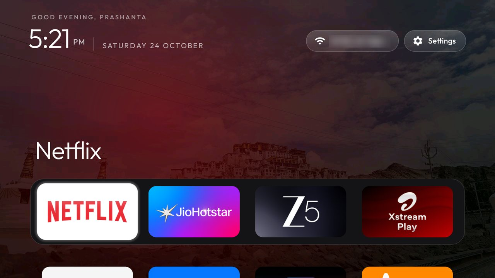
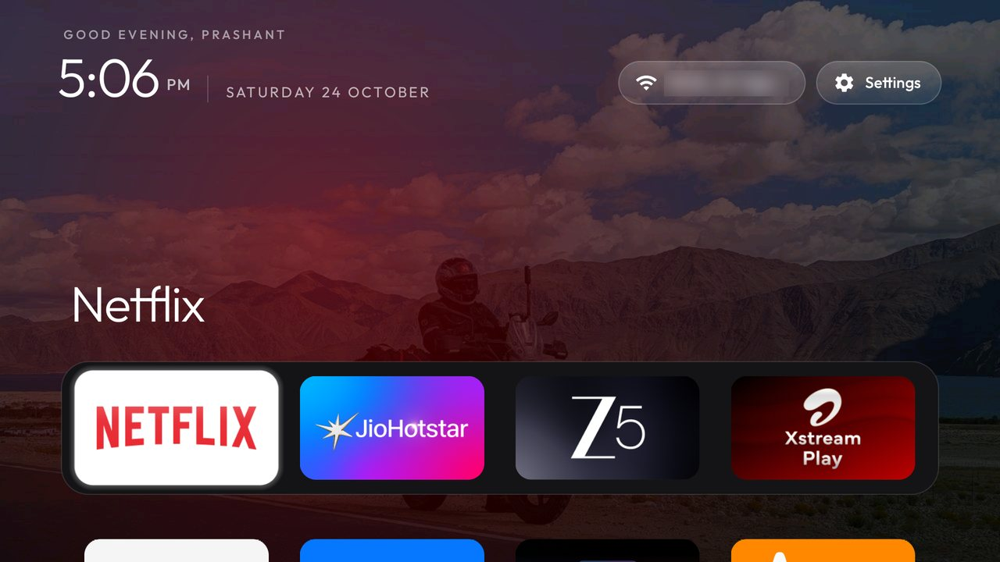
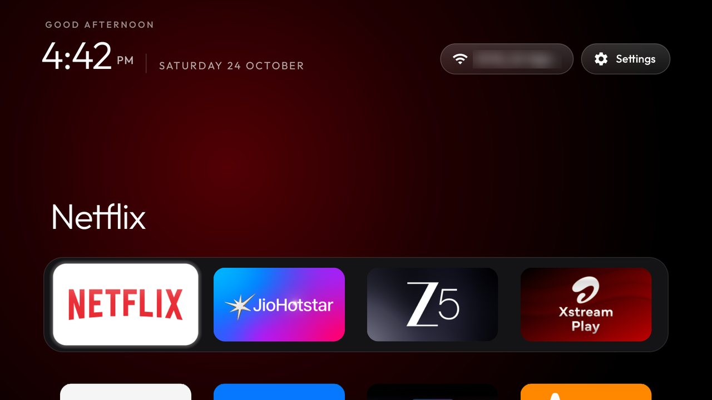
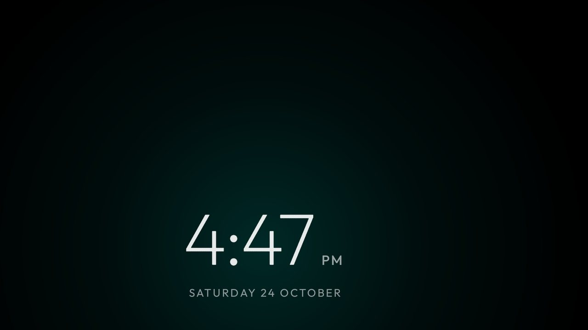

# Xiaomi Mi Box S (MIBOX4), second unit

A second Mi Box S, done with `PROMPT.md` and `examples/xiaomi-mi-box-s/debloat.txt` on 2026-10-21.
Same build as the first unit: `Xiaomi/oneday/oneday:9/PI/3933:user/release-keys`, security patch
2021-07-05, SDK 28, 2 GB RAM, 1920x1080, `ro.adb.secure=1`. Done with `tools/tv.py` (no adb binary)
and the `.ps1` scripts.

## What matched the list

Every package in the list was on this unit and could be disabled with `pm disable-user --user 0`. Disabled
in three batches with screenshots in between (telemetry; PatchWall, rows and updater; casting and
preloads), then the launcher, then Backdrop after `screensaver_components` was set to `ClockDream`.
Nothing broke between batches.

- Home: `com.google.android.tvlauncher` before, as on the first unit. The only other HOME claimant was
  `com.android.tv.settings/.system.FallbackHome`; no setupwraith claim.
- `launcher/build-and-install.ps1` worked first time: `set-home-activity` with the component, the stock
  launcher disabled, `mResumedActivity` on `com.gathin.tvhome/.MainActivity`.
- After a reboot the same 25 packages were disabled: nothing is re-enabled at boot. Home and Wi-Fi came
  back by themselves. `MemAvailable` was 1.08 GB before (box running for a while) and 1.23 GB right after
  the reboot.
- The Wi-Fi pill says only "Wifi": Location is off, as the list header says.
- USB debugging alone opened port 5555 (`service.adb.tcp.port=5555`, `sys.usb.config=adb`).

## Where this unit differed

- **Nothing was disabled before we started** (`pm list packages -d` was empty). The five apps the list
  keeps commented out as "already disabled on this unit" (Prime Video, YouTube Music, Play Movies, Play
  Games, Camera) were all enabled here; they were disabled by choice.
- **Google Play Music** (`com.google.android.music`) was installed and enabled. The service closed in
  2020; disabled with no side effects.
- **The saved Wi-Fi did not belong to setupwraith**: `dumpsys wifi | grep -o 'cname=[^ ]*'` showed
  `android.uid.system:1000` and `com.google.uid.shared:10011` only. setupwraith was not needed for the
  takeover on this Android TV 9 build and was left alone.
- **The remote's Apps button can be made useful.** It sends scancode 580 (`KEY_APPSELECT`), which
  `Vendor_2717_Product_32b9.kl` maps to `ALL_APPS`. Android sends that to `com.android.tv.settings`,
  which does nothing with it (the first unit saw the same, also on the stock launcher). The launcher's
  `HomeKeyService` catches `KEYCODE_ALL_APPS`, so enabling it (`-HomeKeyService` on
  `launcher/build-and-install.ps1`) turns the Apps button into a second Home button. Checked with the
  real remote from inside VLC: the press started `com.gathin.tvhome/.MainActivity`.
- The other buttons, checked with the real remote and `getevent -lt`: Home (`KEY_HOMEPAGE`), Back,
  voice (`KEY_VOICECOMMAND`, Assistant kept) and Netflix (`KEY_VIDEO`, scancode 393 is `NETFLIX` in
  the same `.kl`) all work with the stock launcher disabled.

An empty `live_tv_package` (no tuner) can be pushed as a theme `config.json` with `tools/theme.ps1`,
so `config.xml` stays at its defaults.

## Fourth unit (2026-10-24)

A fourth Mi Box S, done on Windows with Claude and a plain-language version of `PROMPT.md`, no terminal
for the owner. Same build as the first three: `Xiaomi/oneday/oneday:9/PI/3933:user/release-keys`, SDK 28,
2 GB RAM, 1920x1080 at 320 dpi, 5 GB `/data`. The launcher is 2.6.0 (`0bb7f7ed`); nothing in `launcher/`
was changed. The theme is [`examples/xiaomi-mi-box-s/theme/`](../../examples/xiaomi-mi-box-s/theme/README.md).

The result, photographed from the TV itself. LumiFlow rotates the owner's own photos, shuffled, one a minute:

|  |  |  |
|---|---|---|
| *LumiFlow: glass dock, stats line, a darkened photo* | *The next photo in the rotation* | *And the next (greeting name differs: shot before it was renamed)* |

|  |  |
|---|---|
| *The same Home with no wallpaper* | *Clock screensaver (time and date, no pictures)* |

The Wi-Fi network name is blurred in the screenshots. The photos are the owner's own and are not part of the theme.

What differed from the other units:

- **Already half done.** 15 packages were disabled before we started: the whole PatchWall, analytics,
  Alphonso, auto-install and update-service group, plus Live Channels, TalkBack, the print spooler and Play
  Games. We added YouTube Music, Play Movies & TV and Camera (`com.android.camera2`). Prime Video stayed,
  because the owner uses it.
- **Casting and voice kept.** `com.google.android.apps.mediashell`, `com.google.android.katniss`,
  `com.google.android.speech.pumpkin`, `com.google.android.tv.remote.service`, `com.mitv.milinkservice` and
  `com.mitv.videoplayer` stay enabled. After a reboot `mediashell` was installed and enabled and `logcat` had no
  "No private key"; the owner confirmed casting from a phone.
- **setupwraith not needed.** `dumpsys wifi | grep -o 'cname=[^ ]*'` showed only `android.uid.system:1000` and
  `com.google.uid.shared:10004`, so the setup wizard stayed enabled, as on the second unit.
- **Apps button.** Turned into a second Home button without the script switch: with
  `enabled_accessibility_services` unset (`null`), `settings put secure enabled_accessibility_services
  com.gathin.tvhome/.HomeKeyService` and `settings put secure accessibility_enabled 1` (the owner confirmed the
  button opens Home). `theme.ps1` keeps the service across its Home restart. The `AUTO_START` appop line in
  `build-and-install.ps1` prints `Unknown operation string` here; harmless.
- **Screensaver.** `screensaver_components` was `com.google.android.backdrop/...Backdrop`. Switched to
  `com.gathin.tvhome/.ClockDream` first, then disabled Backdrop. `service call dreams 1` is refused to the shell
  (`WRITE_DREAM_STATE`); `am start -n com.android.systemui/.Somnambulator` starts the chosen screensaver
  instead, and `dumpsys dreams` showed `mCurrentDreamName=...ClockDream`.
- **Private DNS** was unset (`null`/`null`). `private_dns_specifier dns.adguard-dns.com` and
  `private_dns_mode hostname` worked: sites loaded, and `doubleclick.net` answered from the local host
  (about 0.2 ms), i.e. blocked. To undo, delete both keys rather than writing a default.
- **Play Store automatic updates** are off from Play Store, profile picture, Settings, "Auto-update apps",
  "Don't auto-update apps". `uiautomator dump` returns `null root node` on the Play Store, so the steps were
  key presses with a screenshot after each. Four updates were waiting; Xstream Play and Prime Video were
  updated by hand. "TV Setup" and "Android TV Remote Service" were left alone on purpose: they are system
  parts that touch Home and pairing.
- **Storage.** `/data` was 68% full (1.6 GB free) with 656 MB of app caches, mostly Hotstar, Zee5 and
  Xstream. `pm trim-caches 4G` took it to 2.3 GB free (53% used) with no sign-ins lost.
- **USB debugging off.** `settings put global adb_enabled 0` closed port 5555 at once (checked from the PC);
  8008 stays open because casting uses it. Turn debugging on again to change anything.

Numbers (the "before" box had been on 26 minutes, the "after" 3 minutes after a reboot, so some of the gain
is the reboot): `MemAvailable` 908 MB, then 1,028 MB; memory in use 1,079 MB, then 959 MB; swap 14 MB, then
12 MB. The stock home held 74 MB, the new one 22 MB; Backdrop held about 63 MB when it ran.

Two things worth knowing:

- Wallpaper rotation is in whole minutes (`integer(..., 0, 1440)` in `Config.java`), so `0.25` becomes `0`
  and the rotation stops. One minute is the fastest the 2.6.0 launcher can do.
- The launcher's Clock screensaver shows time and date only, never pictures.

## Building on Windows without Android Studio

`launcher/build-and-install.ps1` looks for a JDK only in `JAVA_HOME` or Android Studio's `jbr`. A
Temurin JDK 17 zip plus the Android command-line tools (`sdkmanager "platforms;android-34"
"build-tools;34.0.0"`, SDK in `%LOCALAPPDATA%\Android\Sdk`) worked with `JAVA_HOME` set to the JDK.

On the fourth unit Android Studio's `jbr` was found by the script, but the Gradle wrapper failed with
`Downloading ... gradle-8.9-bin.zip failed: timeout (10000ms)` on a slow line (twice, also at 120 s).
`curl -L -C - --retry 20 --retry-all-errors` fetched the zip in about 8 minutes; its SHA-256 matched
`distributionSha256Sum` in `launcher/gradle/wrapper/gradle-wrapper.properties`. Pointing `distributionUrl` at the
local file (`file:///C:/.../gradle-8.9-bin.zip`) for that one build let it finish, and the properties file was
put back with `git checkout` afterwards. `tools/venv` is also needed before the script runs
(`python -m venv tools\venv` then `tools\venv\Scripts\python.exe -m pip install -r tools\requirements.txt`).

Lived with: one day so far on the fourth unit; still to soak for a few days as CONTRIBUTING.md asks.
