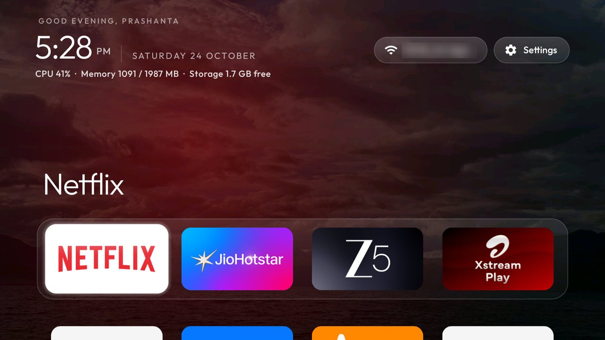

# LumiFlow (Mi Box S theme)

A device theme for the Xiaomi Mi Box S (MIBOX4, Android TV 9, 2 GB): frosted-glass dock over rotating
photos, an app library button, one stats line under the clock and calmer motion. It is only a
`config.json`: no launcher code changes and no pictures are shipped. "LumiFlow" is just this folder's
name, not a registered brand.



*A screenshot from the TV. The Wi-Fi network name is blurred. The picture behind it is the owner's own photo and is not included; more screenshots are in [the Mi Box guide](../../../docs/devices/xiaomi-mi-box-s.md).*

| Key | Why |
|---|---|
| `dock_apps` | YouTube, Netflix, Hotstar and Zee5 first. Change these to your four apps (`pm list packages -3`). |
| `live_tv_package: ""` | The box has no tuner, so the Inputs menu has nothing to offer. |
| `wallpaper`, `wallpaper_rotation_minutes: 1`, `wallpaper_order: shuffle` | Rotates the pictures in `wallpapers/`. The interval is whole minutes: 1 is the fastest, and `0.25` is read as `0`, which stops the rotation. |
| `dock_glass`, `dock_opacity: 75` | The dock band as frosted glass, so the picture shows behind the tiles. |
| `app_library` | An App library pill after the last Home row. |
| `show_stats` | CPU, memory and free storage under the clock. |
| `reduced_motion` | Less bounce and fading; kinder to a 2 GB box. |

## Your own photos

Pictures are not included. Make a `wallpapers/` folder next to `config.json` and put JPEG, PNG or WebP
files in it, then push the folder:

```powershell
tools\theme.ps1 -TvHost <tv ip> examples\xiaomi-mi-box-s\theme
```

Without pictures the theme still works: Home keeps its plain colour.

On a 2 GB box a full-colour photo is heavy and a bright one drowns the clock and the tiles. Save each
picture as a 1280×720 JPEG under about 300 KB, and darken it in the picture itself, so `wallpaper_dim`
can stay at 0. Use pictures you have the right to show.

Remove it with `tools\theme.ps1 -TvHost <tv ip> -Reset`.
